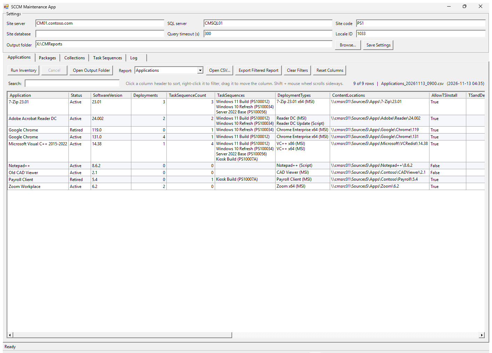
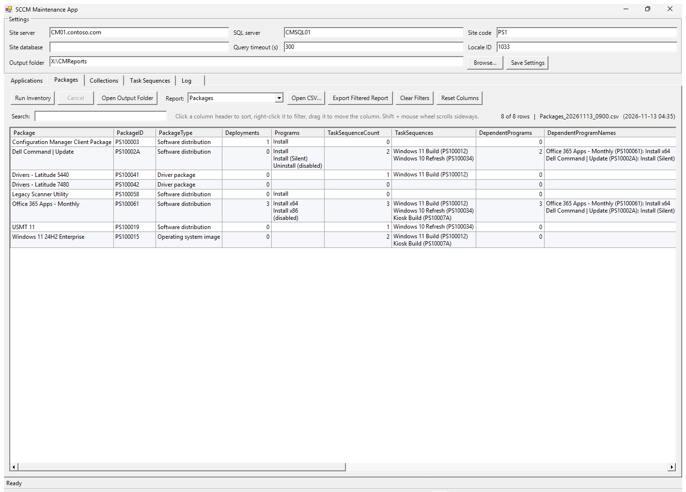
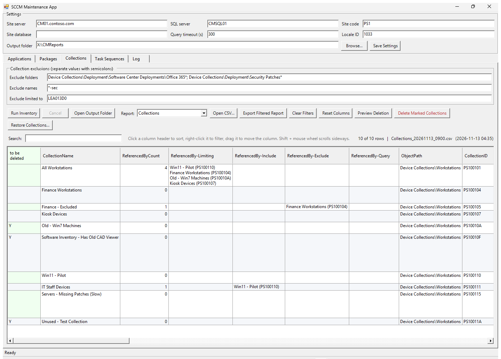
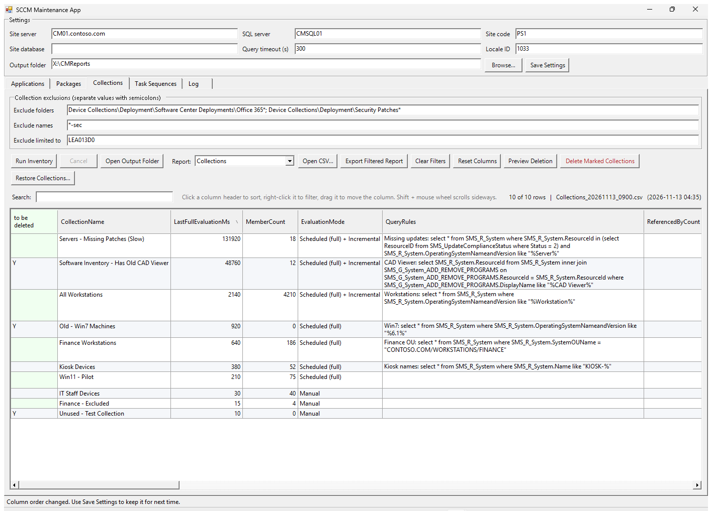
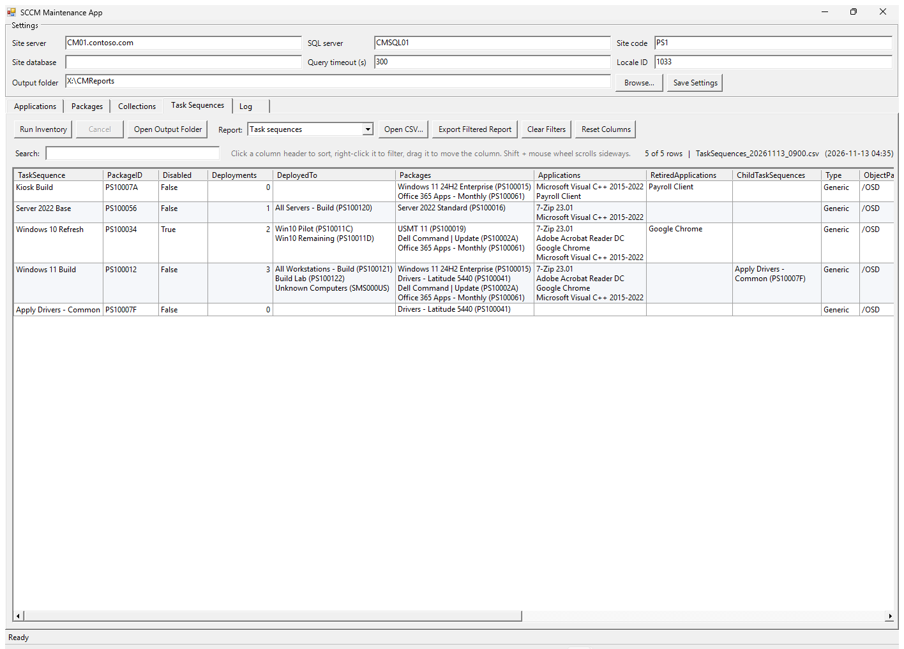
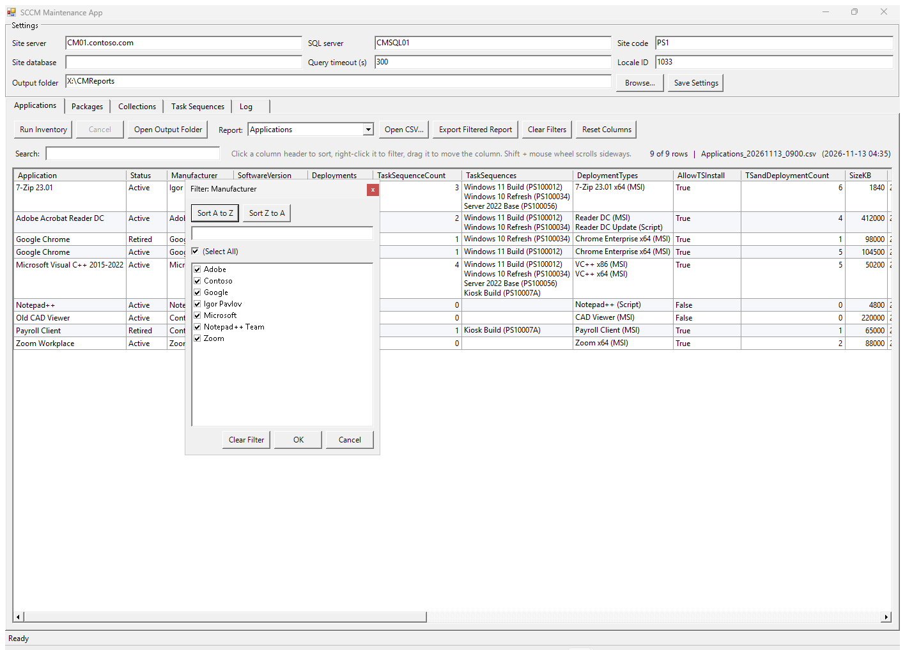
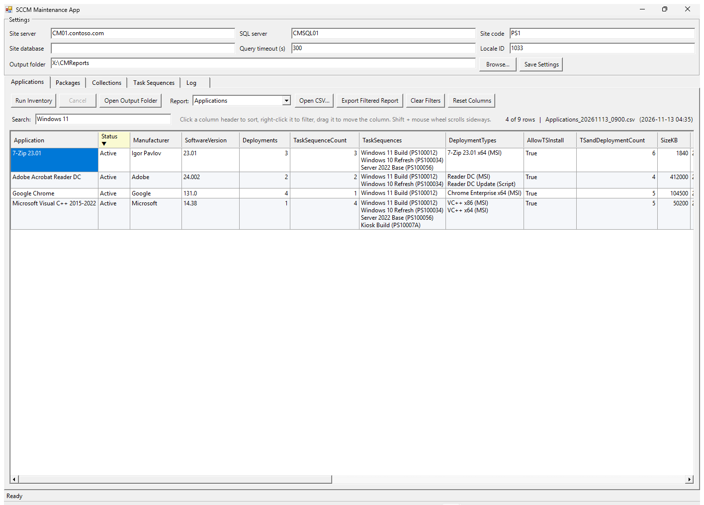
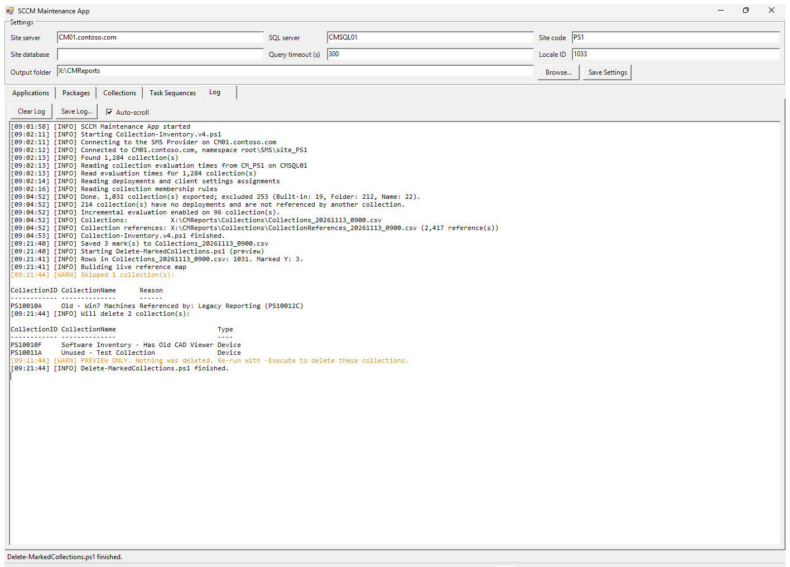
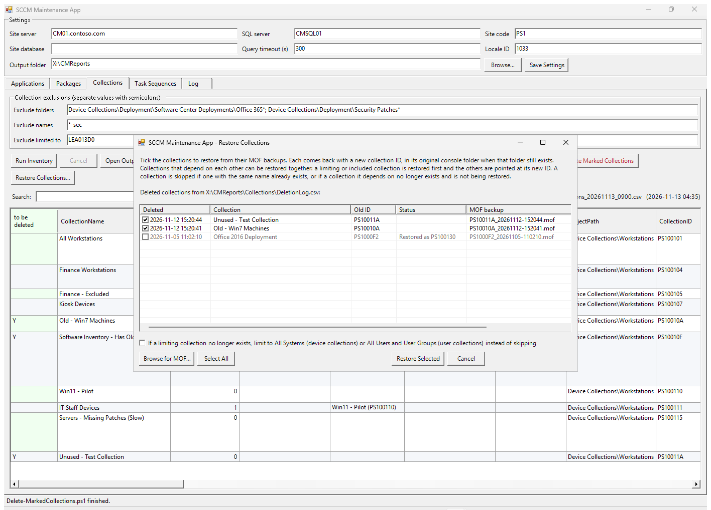

# CM_Application_Cleanup

Tools for finding Configuration Manager (ConfigMgr / MECM) applications, packages, collections and task sequences that can be retired or removed, and a Windows app that runs them.

| Script | What it does | Reads |
| --- | --- | --- |
| `SCCM-MaintenanceApp.ps1` | Windows app that runs the scripts below and shows their reports; start it with `SCCM-MaintenanceApp.bat` | |
| `Get-CMApplicationInventory.ps1` | Application inventory | Site database (SQL) |
| `Get-CMPackageInventory.ps1` | Package inventory: standard, driver, OS image, OS upgrade and boot image packages | Site database (SQL) |
| `Get-CMTaskSequenceInventory.ps1` | Task sequence inventory | Site database (SQL) |
| `Collection-Inventory.v4.ps1` | Collection inventory with collection-to-collection references | SMS Provider (WMI) |
| `Delete-MarkedCollections.ps1` | Deletes collections marked `Y` in a collection inventory, after checking and backing up each one | SMS Provider and ConfigMgr console module |
| `Restore-DeletedCollections.ps1` | Restores deleted collections from the MOF backups written by `Delete-MarkedCollections.ps1` | SMS Provider and ConfigMgr console module |

All scripts except `Delete-MarkedCollections.ps1` and `Restore-DeletedCollections.ps1` are read-only.

## Standard parameters

Every script uses the same parameter names for the same settings and takes the ones it needs:

| Parameter | Meaning | Applications | Packages | Task sequences | Collections | Delete |
| --- | --- | :-: | :-: | :-: | :-: | :-: |
| `-SqlServer` | SQL Server hosting the site database, e.g. `cmsql01` or `cmsql01\INSTANCE` | ✓ | ✓ | ✓ | optional | |
| `-Database` | Site database name; defaults to `CM_<SiteCode>` | ✓ | ✓ | ✓ | optional | |
| `-SiteServer` | Server hosting the SMS Provider | | | | ✓ | ✓ |
| `-SiteCode` | Site code | ✓ | ✓ | ✓ | ✓ | ✓ |
| `-OutputDirectory` | Folder for the reports (and, for Delete, the deletion log and backups) | ✓ | ✓ | ✓ | ✓ | ✓ |
| `-QueryTimeout` | SQL command timeout in seconds (default `300`) | ✓ | ✓ | ✓ | optional | |
| `-LocaleId` | Locale for application names (default `1033`) | ✓ | | ✓ | | |

Reports are named `<Report>_<yyyyMMdd_HHmm>.csv`. Every script logs lines in the form `[HH:mm:ss] [LEVEL] message`, returns its main report rows on the pipeline, and writes an empty file for a report with no rows so every path in the log exists. The SQL scripts stop with an error if they cannot connect to the site database.

## SCCM-MaintenanceApp.ps1

Double-click `SCCM-MaintenanceApp.bat`, or run:

```powershell
powershell.exe -ExecutionPolicy Bypass -File .\SCCM-MaintenanceApp.ps1
```

The batch file starts the app from the folder it is in, without a console window, so it works wherever the repo is cloned.

**SCCM Maintenance App** has a tab for each inventory (Applications, Packages, Collections, Task Sequences) and a Log tab.

- **Settings** at the top are shared by every tab: site server, SQL server, site code, site database, query timeout, locale ID and output folder. The Collections tab adds the collection exclusions. **Save Settings** writes them all to `SCCM-MaintenanceApp.settings.json` next to the script, and they are loaded at the next start.
- **Run Inventory** runs the tab's script in the background. The window stays responsive, the script's log is shown live in the Log tab, the status bar shows its latest line and progress, and **Cancel** stops it. When it finishes, its main report is shown.
- **Open Output Folder** opens the tab's report folder. Reports go to a subfolder per tab under the output folder: `Applications`, `Packages`, `Collections`, `TaskSequences`.
- **Report** picks which of the tab's reports to show; the latest file of that kind in the folder is loaded. **Open CSV...** shows any other report file.
- The grid sorts when you click a column header. Right-click a header for an Excel-style filter: sort buttons, a checklist of the values (with its own search box and Select All) and Clear Filter. Filtered columns are highlighted and marked ▼. **Search** filters rows containing the text in any column. Numbers and dates sort and filter as numbers and dates.
- Cells that list several items, such as an application's `TaskSequences` or a collection's `IncludeCollections`, show one item per line, and rows grow to fit them. The CSV files and exports keep the items on one line, separated by `; ` (or ` | ` in the collection reports).
- Drag a column header to move the column. The order is kept for each kind of report (e.g. the Applications report) and is saved by **Save Settings**, so it is used the next time the app opens. **Reset Columns** puts the report's columns back in the script's order. Shift + mouse wheel scrolls the grid sideways.
- **Export Filtered Report** saves the rows and columns shown, in the order shown, to a new CSV. **Clear Filters** removes all filters and the search text.
- The **Log** tab shows every script's output, with warnings in orange and errors in red. It is also appended to `SCCM-MaintenanceApp_<yyyyMMdd>.log` in the output folder.

To delete collections from the Collections tab:

1. Show the Collections report and enter `Y` in the green `to be deleted` column of each collection to delete.
2. **Preview Deletion** saves the marks to the report CSV and runs `Delete-MarkedCollections.ps1` without deleting anything. The Log tab shows which collections would be deleted and which are skipped, and why.
3. **Delete Marked Collections** saves the marks, asks you to type `DELETE`, then runs the script with `-Execute`. Each collection is checked against the live site and backed up before it is deleted.

**Restore Collections...** lists the collections in the Collections folder's `DeletionLog.csv` that have a MOF backup, newest first, with any already restored shown in grey with their new ID. Tick the ones to restore (or **Browse for MOF...** to add backups from elsewhere), click **Restore Selected** and confirm; `Restore-DeletedCollections.ps1` runs in the background and its log is shown in the Log tab.

Requirements: Windows PowerShell 5.1, and the access each script needs (below). The scripts must be in the same folder as the app.

### Screenshots

The screenshots use sample data from a fictional site. In some of them the columns have been dragged so the list columns are in view.

**Applications tab.** Lists of task sequences, deployment types and content locations show one item per line.



**Packages tab**, with each package's programs, the task sequences that use it and the programs that run it first.



**Collections tab.** The collection exclusions are at the top and the deletion and restore buttons are in the toolbar. Collections marked `Y` in the green `to be deleted` column are deleted by **Delete Marked Collections**.



**Finding slow collection evaluations.** Here the Collections report is sorted by `LastFullEvaluationMs`, largest first, with that column dragged next to the name. The slowest collections and their query rules are at the top.



**Task Sequences tab**, with each task sequence's deployments, packages, applications (retired ones listed separately) and child task sequences.



**Column filter.** Right-click a column header to open it.



**A filtered report.** `Status` is filtered to Active (highlighted, marked ▼) and the search box shows the rows that mention Windows 11. The row count shows 4 of 9 rows.



**Log tab** after a collection inventory and a deletion preview. Warnings are in orange.



**Restore Collections.** Deleted collections with a MOF backup are listed. Ones already restored are greyed out and show their new ID.



## Get-CMApplicationInventory.ps1

Builds an inventory of every application in a ConfigMgr site so you can decide what to clean up. It reads the site database directly over SQL, which is much faster than the ConfigurationManager cmdlets on sites with hundreds of applications and task sequences. The ConfigMgr console is not needed.

For each application (latest revision) it reports:

| Column | Meaning |
| --- | --- |
| TSandDeploymentCount | `Deployments` plus `TaskSequenceCount`; 0 means nothing deploys or installs the application |
| Status | `Active`, or `Retired` when the application is retired |
| IsSuperseded | Whether a newer application supersedes it |
| Deployments | Number of deployments of the application (task sequence deployments are not counted) |
| DeploymentTypes | Deployment type names and technology, in priority order |
| ContentLocations | Content source paths of the deployment types |
| SizeKB | Total size of the deployment types' content in KB, from the file sizes recorded in ConfigMgr when the content was last updated. Content shared between deployment types is counted once |
| TaskSequences | Task sequences with an Install Application step that references it, including retired applications and applications installed by a child task sequence |
| AllowTSInstall | Whether it can be installed by a task sequence without being deployed |
| DependentDTs | Number of deployment types in other applications that depend on it (an application with dependents is not flagged as unused) |
| ObjectPath | Console folder, e.g. `/Software/Adobe` (`/` is the root folder) |

It also logs a summary that highlights cleanup candidates and problems:

- Active applications with no deployments, no task sequence references and no dependent deployment types (likely unused)
- Retired applications still referenced by task sequences (the task sequence will fail or needs updating before removal)
- Applications referenced by task sequences that do not allow task sequence install without a deployment

### Output

Written to `-OutputDirectory` (default `.\AppInventory`):

- `Applications_<timestamp>.csv` - one row per application, starting with `Application`, `TSandDeploymentCount`, `SizeKB`, `DateCreated`, `DateLastModified` and `CreatedBy`
- `DeploymentTypes_<timestamp>.csv` - one row per deployment type in priority order, with technology, content location, content size in KB and install and uninstall commands
- `TaskSequenceReferences_<timestamp>.csv` - one row per task sequence and application pair. `TaskSequenceDeployments` is the number of deployments of the task sequence; `Deployments` is the number of deployments of the application, the same value as in the applications report

### Requirements

- PowerShell 5.1 or later
- Read access to the site database with Windows authentication (`db_datareader`, or the ConfigMgr reporting role `smsschm_users`)
- Tested against ConfigMgr 2603. Columns that differ between versions are read when present; when missing, text columns are left blank and counts are 0.

### Usage

```powershell
.\Get-CMApplicationInventory.ps1 -SqlServer cmsql01.contoso.local -SiteCode PS1

# Named instance and explicit database name; list retired apps still used by task sequences
$apps = .\Get-CMApplicationInventory.ps1 -SqlServer cmsql01\CONFIGMGR -Database CM_PS1
$apps | Where-Object { $_.Status -eq 'Retired' -and $_.TaskSequenceCount } |
    Format-Table Application, TaskSequences
```

Parameters: `-SqlServer` (required), `-SiteCode` or `-Database`, `-LocaleId`, `-OutputDirectory` (default `.\AppInventory`) and `-QueryTimeout`; see [Standard parameters](#standard-parameters).

### Limitations

- An application installed by a child task sequence is listed against both the child and the parent, one level deep. Deeper nesting is not followed.
- Task sequence references come from `v_TS_AppReferences_Flat`. On sites without that view the script falls back to `v_TaskSequenceAppReferencesInfo` and logs a warning; that view omits retired applications, so the retired-in-task-sequence check will miss them.
- Applications installed from a dynamic variable list (Install Application step using a base variable name) are not detected as references.
- The script is read-only; it does not change or delete anything in ConfigMgr.

## Get-CMPackageInventory.ps1

The same inventory for packages: standard packages, driver packages, operating system images, operating system upgrade packages, boot images and the legacy package types. Software update packages, task sequences and application content packages are left out. Like the application script it reads the site database directly over SQL.

For each package it reports:

| Column | Meaning |
| --- | --- |
| PackageType | `Package`, `Driver package`, `Operating system image`, `Operating system upgrade package`, `Boot image`, ... |
| BuiltIn | `True` for packages the site creates and maintains (client install, piloting and upgrade packages, Easy Setup package); these are not flagged as unused |
| SourcePath | Package source path |
| SizeKB | Size of the package source in KB, as recorded when the content was last updated |
| Deployments | Number of deployments of the package's programs (task sequence deployments are not counted) |
| Programs | Program names; disabled programs are marked `(disabled)` |
| TaskSequences | Task sequences that reference the package in a step or as their boot image, including packages used by a child task sequence |
| AllowTSInstall | Whether any program can be installed by a task sequence without being deployed; blank when the package has no programs |
| RunsFirst | Programs in other packages that its programs run first ("Run another program first") |
| DependentPrograms | Number of programs in other packages that run one of its programs first (a package with dependents is not flagged as unused); `DependentProgramNames` lists them |
| ObjectPath | Console folder, e.g. `/Drivers/Dell` (`/` is the root folder) |

It also logs a summary that highlights cleanup candidates and problems:

- Packages with no deployments, no task sequence references and no dependent programs (likely unused). Boot images and built-in packages are not counted, because boot images are also used for PXE and boot media and built-in packages are used by the site.
- Task sequence references to packages or programs that no longer exist
- Task sequence references to programs that do not allow task sequence install without a deployment
- Programs that run another program first that no longer exists

### Output

Written to `-OutputDirectory` (default `.\PackageInventory`):

- `Packages_<timestamp>.csv` - one row per package
- `Programs_<timestamp>.csv` - one row per program, with command line, disabled state, deployments, the program it runs first and the programs that run it first
- `TaskSequenceReferences_<timestamp>.csv` - one row per task sequence and package pair. `Via` names the child task sequences, run by a Run Task Sequence step, that also reference the package; the package may also be used by the parent's own steps. Program is blank when the step uses the package content without running a program (driver packages, OS images, Run Command Line). `TaskSequenceDeployments` is the number of deployments of the task sequence; `Deployments` is the number of deployments of the package

### Usage

```powershell
.\Get-CMPackageInventory.ps1 -SqlServer cmsql01.contoso.local -SiteCode PS1

# Driver packages no task sequence uses, largest first
$packages = .\Get-CMPackageInventory.ps1 -SqlServer cmsql01\CONFIGMGR -Database CM_PS1
$packages | Where-Object { $_.PackageType -eq 'Driver package' -and -not $_.TaskSequenceCount } |
    Sort-Object SizeKB -Descending | Format-Table Package, PackageID, SizeKB
```

Parameters are the same as the application script, without `-LocaleId`; the default output folder is `.\PackageInventory`.

### Limitations

- A package used by a child task sequence is listed against both the child and the parent. The reference view already includes nested task sequences; `Via` is worked out one level deep.
- Task sequence references come from `v_TaskSequenceReferencesInfo` (or `v_TaskSequencePackageReferences` when that view is missing). When the site does not record which program a step runs, the `AllowTSInstall` check is made at package level, so a package used only by a Run Command Line or Download Package Content step can be flagged although it needs no program.
- When a package is deleted, ConfigMgr removes it from the task sequence reference views, but a step that used it keeps the deleted PackageID and fails at run time. Such steps are not detected; the task sequence XML that holds them is stored in an encoded form in the database.
- When a package is deleted, ConfigMgr also clears "Run another program first" on programs that ran its programs, so the broken run-first check only finds chains left behind outside the site's control.
- Packages installed from a dynamic variable list (Install Package step using a base variable name) are not detected as references.
- Boot images used only for PXE or boot media show no task sequence references.
- The script is read-only; it does not change or delete anything in ConfigMgr.

## Get-CMTaskSequenceInventory.ps1

Inventories every task sequence from the site database over SQL, like the application and package scripts.

For each task sequence it reports:

| Column | Meaning |
| --- | --- |
| Type | `Generic`, or `OS deployment` when it has operating system steps |
| Disabled | "Disable this task sequence on computers where it is deployed" is set |
| Deployments | Number of deployments; `DeployedTo` lists the target collections |
| BootImage | Boot image set on the task sequence |
| ParentTaskSequences | Task sequences that run it with a Run Task Sequence step |
| ChildTaskSequences | Task sequences it runs with a Run Task Sequence step |
| Packages | Packages it uses, including the boot image and the packages of its child task sequences |
| Applications | Applications it installs, including retired ones; `RetiredApplications` lists the retired ones |
| ContentSizeKB | Total source size of the referenced packages in KB (applications not included) |
| ObjectPath | Console folder (`/` is the root folder) |

The log summary lists task sequences with no deployments that no other task sequence runs (likely unused), disabled task sequences that are still deployed or run by another task sequence, and task sequences that install retired applications.

### Output

Written to `-OutputDirectory` (default `.\TaskSequenceInventory`):

- `TaskSequences_<timestamp>.csv` - one row per task sequence
- `TaskSequenceReferences_<timestamp>.csv` - one row per task sequence and referenced package, child task sequence or application, with its type, program, application status and size

### Usage

```powershell
.\Get-CMTaskSequenceInventory.ps1 -SqlServer cmsql01.contoso.local -SiteCode PS1

# Task sequences nothing deploys or runs
$ts = .\Get-CMTaskSequenceInventory.ps1 -SqlServer cmsql01\CONFIGMGR -Database CM_PS1
$ts | Where-Object { -not $_.Deployments -and -not $_.ParentTaskSequences } | Format-Table TaskSequence, PackageID, SourceDate
```

### Limitations

- The package references view includes the content of child task sequences, so a parent lists its children's packages as well as its own.
- Steps that point at deleted packages are not reported; see the package script's limitations.

## Collection-Inventory.v4.ps1

Inventories every collection through the SMS Provider, with the collections that reference each one (limiting, include, exclude and query rules), deployments by type, membership rules and evaluation settings. Built-in collections and collections matching `-ExcludeFolder`, `-ExcludeName` or `-ExcludeLimitedTo` are left out of the report, but their references to other collections still count.

Written to `-OutputDirectory` (default `.\CollectionInventory`):

- `Collections_<timestamp>.csv` - one row per collection, starting with an empty `to be deleted` column for marking collections for `Delete-MarkedCollections.ps1`
- `CollectionReferences_<timestamp>.csv` - one row per reference between two collections

`LastFullEvaluationMs` is how long each collection's last full evaluation took, in milliseconds, as shown by Collection Evaluation Viewer. Sort it largest first to find the collections with the slowest queries. ConfigMgr keeps only the last run, and only in the site database (`Collections_L`), so it is filled in only when `-SqlServer` is given (in the app: when the SQL server setting is filled in). If the database cannot be read, a warning is logged and the column is left blank.

```powershell
.\Collection-Inventory.v4.ps1 -SiteServer CM01 -SiteCode PS1 -OutputDirectory C:\Reports\Collections
.\Collection-Inventory.v4.ps1 -SiteServer CM01 -SiteCode PS1 -ExcludeName '*-sec', '*Pilot*' -ExcludeLimitedTo @()
```

| Parameter | Description |
| --- | --- |
| `-SiteServer` | SMS Provider server (default: this computer) |
| `-SiteCode` | Site code (default `LEA`); pass `''` to detect it |
| `-OutputDirectory` | Folder for the reports (default `.\CollectionInventory`) |
| `-ExcludeFolder` | Console folder patterns to leave out, `*` as wildcard (default: the Office 365 and Security Patches deployment folders); `@()` turns it off |
| `-ExcludeName` | Name patterns to leave out, `*` as wildcard: `*-sec` ends with, `*Pilot*` contains, `Test -*` starts with (default `*-sec`); `@()` turns it off. A pattern without `*` must match the whole name, and `[` `]` are wildcard characters (write a literal `[` as `[[]`) |
| `-ExcludeLimitedTo` | Limiting collection IDs to leave out (default `LEA013D0`); `@()` turns it off |
| `-SqlServer` | SQL Server hosting the site database; optional, used only for `LastFullEvaluationMs` |
| `-Database` | Site database name (default `CM_<SiteCode>`) |
| `-QueryTimeout` | SQL command timeout in seconds (default `300`) |

Requires access to the SMS Provider over DCOM, as the ConfigMgr console uses, and for `LastFullEvaluationMs` read access to the site database with Windows authentication.

## Delete-MarkedCollections.ps1

Deletes the collections marked `Y` in the `to be deleted` column of a `Collections_<timestamp>.csv`. Each marked collection is checked against the live site first and skipped, with the reason logged, when it is built in, no longer exists, has been renamed, has deployments (including client settings and antimalware policies), is referenced by another collection, or is listed twice. Each collection that passes is backed up before it is deleted, to two files in `DeletionBackups`: `<CollectionID>_<run>.json` with its properties and membership rules, and `<CollectionID>_<run>.mof` exported with `Export-CMCollection`. If either backup fails, the collection is not deleted.

To restore a deleted collection, use `Restore-DeletedCollections.ps1` (or **Restore Collections...** in the app), or import its MOF with the console's **Import Collections** wizard or `Import-CMCollection`. The collection comes back with a new collection ID, so update anything that referred to the old ID. Its limiting collection and any collections its include or exclude rules name must still exist.

## Restore-DeletedCollections.ps1

Imports MOF backups written by `Delete-MarkedCollections.ps1` with `Import-CMCollection`. Restored collections get new collection IDs, so:

- **Collections that depend on each other can be restored together.** The MOFs are restored in dependency order (a collection's limiting collection and the collections its include and exclude rules name go first), and references to a restored collection's old ID in the MOFs restored after it are changed to its new ID: limiting collection, include and exclude rules, and collection IDs in query rules. Collections restored in earlier runs are matched the same way, from `RestoreLog.csv`. A collection limited to another can only be deleted after it, so restore them in the same run, or the parent first.
- **A collection is skipped**, with the reason logged, when a collection with the same name already exists, or when its limiting collection or a collection named by its include or exclude rules no longer exists and is not being restored.
- **`-UseDefaultLimitingCollection`** restores a collection whose limiting collection no longer exists by limiting it to All Systems (device collections) or All Users and User Groups (user collections) instead of skipping it. This can widen its membership; each change is logged. In the app it is the checkbox at the bottom of **Restore Collections**.

When the JSON backup next to the MOF records a console folder that still exists, the collection is moved back to that folder. Every action is appended to `RestoreLog.csv` in `-OutputDirectory` (default: the folder above the MOF's `DeletionBackups` folder, i.e. the collection report folder) with the old and new IDs. The MOF backups themselves are never changed; references are rewritten in a temporary copy.

```powershell
.\Restore-DeletedCollections.ps1 -MofPath .\CollectionInventory\DeletionBackups\PS10012A_20261112-035449.mof -SiteServer CM01 -SiteCode PS1

# Everything in the backup folder, limiting orphans to All Systems / All Users and User Groups
.\Restore-DeletedCollections.ps1 -MofPath (Get-ChildItem .\CollectionInventory\DeletionBackups\*.mof) -SiteServer CM01 -SiteCode PS1 -UseDefaultLimitingCollection
```

Requires the ConfigMgr console on the machine running it, for `Import-CMCollection`.

Without `-Execute` it only shows what it would do. With `-Execute` it asks you to type `DELETE`, unless `-Force` is passed (the Maintenance App asks first and passes `-Force`). Every action is appended to `DeletionLog.csv` and backups go to `DeletionBackups` in `-OutputDirectory`, which defaults to the folder of the input CSV.

```powershell
.\Delete-MarkedCollections.ps1 -InputPath .\CollectionInventory\Collections_20261025_1200.csv -SiteServer CM01 -SiteCode PS1
.\Delete-MarkedCollections.ps1 -InputPath .\CollectionInventory\Collections_20261025_1200.csv -SiteServer CM01 -SiteCode PS1 -Execute
```

Requires the ConfigMgr console on the machine running it, for the delete cmdlets.
